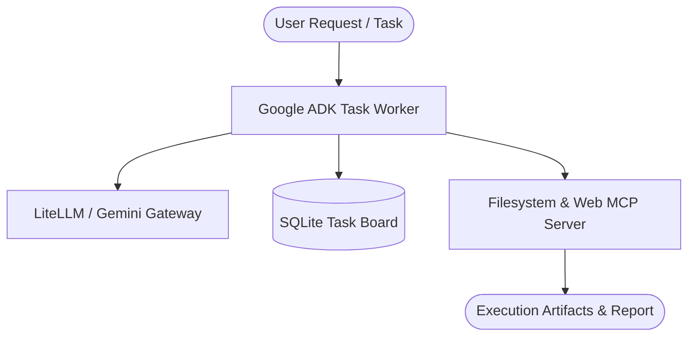

# Daily Architecture & Project Proposal
**Proposal ID:** `PROP-20261016-GOOGLE-A` | **Date:** Friday, October 16, 2026 | **Target Schedule:** 09:00 AM Cairo

> **Workflow Rule:** This document is an uncommitted local proposal. No code has been pushed or committed to your GitHub profile.

---

## 🌟 Part 1: Elevating Existing Repos to Perfection

### Target Repository: `advanced_engineering_team`
* **Current Status:** README exists (3782 bytes)
* **Mermaid Visuals:** ❌ Missing (Priority to Add)
* **Tech Badges:** ❌ Needs professional Shields.io badges
* **Automated Tests:** ⚠️ No dedicated test suite detected

#### Recommended Immediate Action for `advanced_engineering_team`:
1. **Architecture & Visual Flow:** Insert a clear Mermaid architecture flowchart showing the component hierarchy and data flow.
2. **Tech Stack & Badges:** Add clean badges for language, framework, build tools, and license.
3. **Usage & Testing Instructions:** Provide copy-pasteable CLI commands to run and verify the codebase.

---

## 🚀 Part 2: Curriculum Deep-Dive Milestone (No Dummy Projects)

### **Project Title:** Autonomous Multi-Agent Task Orchestrator with Google ADK & Gemini

**Curriculum Source:** Course track `agents`

### 1. What You Learn / Study Focus
Google ADK architecture, Agent-to-Agent (A2A) protocol, tool dispatching, and LiteLLM model fallback routing.

### 2. Architecture & Visual Overview
Build an autonomous multi-agent task coordinator utilizing Google Agent Development Kit (ADK), Gemini Flash/Pro, and SQLite-backed persistent state boards.



### 3. Tech Stack & Frameworks
- `Python 3.11+`
- `Google ADK`
- `Gemini 1.5/2.0 API`
- `LiteLLM`
- `SQLite`
- `MCP (Model Context Protocol)`

### 4. Step-by-Step Implementation Plan
1. **Phase 1:** Initialize Google ADK workspace with uv or poetry
2. **Phase 2:** Implement SQLite task queue with state transitions (PENDING, RUNNING, COMPLETED, FAILED)
3. **Phase 3:** Configure Gemini 2.0 / LiteLLM adapter for structured reasoning
4. **Phase 4:** Integrate Model Context Protocol (MCP) server for isolated tool execution
5. **Phase 5:** Implement evaluation script to benchmark task completion reliability

## 📱 Part 3: Ready-to-Publish LinkedIn Post Draft

*Copy and paste directly to your LinkedIn feed to share your learning journey and technical depth:*

```text
🚀 Excited to share my latest technical milestone in Agentic AI Engineering!

Today I mapped out the architecture for: Autonomous Multi-Agent Task Orchestrator with Google ADK & Gemini.

💡 What it solves:
Build an autonomous multi-agent task coordinator utilizing Google Agent Development Kit (ADK), Gemini Flash/Pro, and SQLite-backed persistent state boards.

🛠️ Core Tech Stack:
• Python 3.11+
• Google ADK
• Gemini 1.5/2.0 API
• LiteLLM
• SQLite
• MCP (Model Context Protocol)

Key Engineering Highlights:
1. Initialize Google ADK workspace with uv or poetry
2. Implement SQLite task queue with state transitions (PENDING, RUNNING, COMPLETED, FAILED)
3. Configure Gemini 2.0 / LiteLLM adapter for structured reasoning

I believe building production-grade AI systems requires moving beyond simple prompt wrappers into stateful multi-agent orchestration, deterministic tool calling, and automated evaluation guardrails.

Explore my interactive AI Digital Twin and project repositories:
👉 https://github.com/yousefattaff/YousefAlsayed-DigitalTwin

#AI #AgenticAI #MachineLearning #Python #FullStack #SystemDesign #OpenSource #SoftwareEngineering
```

---

## ⚡ Part 4: Approval & Frictionless GitHub Push

If you wake up at 9:00 AM, like this proposal, and want it pushed to GitHub without hassle:

1. **Reply to the email:** Hit reply with `push to github` or `approve`.
2. **Run local command:** In your terminal, run:
   ```bash
   npm run approve PROP-20261016-GOOGLE-A
   ```
3. **Tell Antigravity in Chat:** Tell me *"Approve PROP-20261016-GOOGLE-A and push to GitHub"*, and I'll review and push the commit for you.

